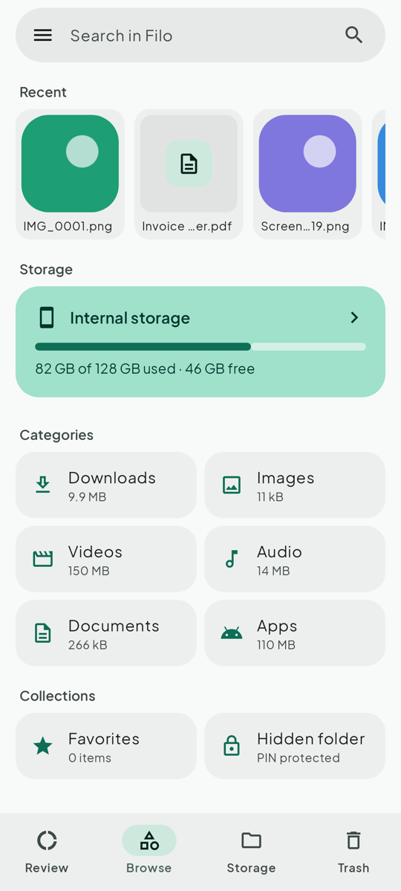
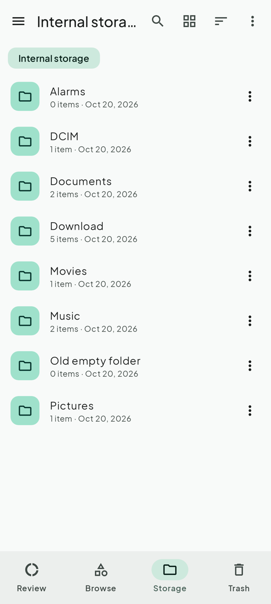
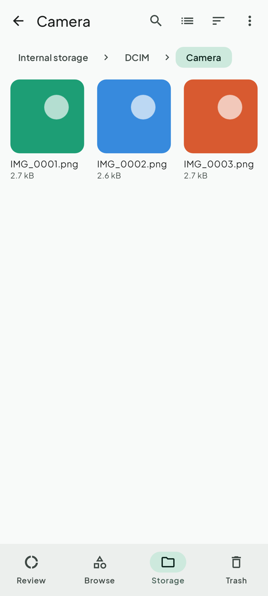
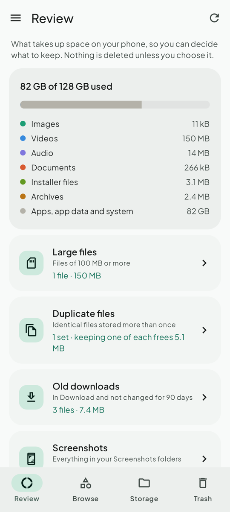
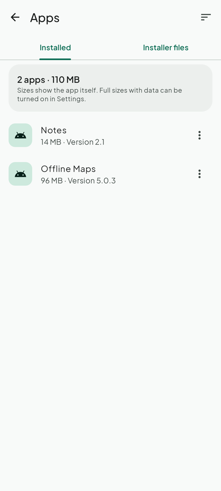
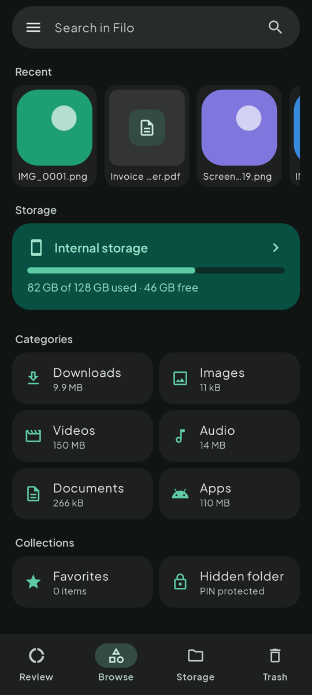

# Filo

A private file manager for Android that looks and feels like Files by Google, without anything from Google inside.

- **Offline unless you ask.** Filo only uses the network for file servers you switch on (SMB, FTP), and only on your home network or your own VPN. Everything else stays on your phone.
- **No Google Play Services, Firebase, analytics or trackers.** Works great on GrapheneOS.
- Built with Kotlin, Jetpack Compose and Material 3 (Material You colors from your wallpaper on Android 12+).
- Runs on Android 8.0 and newer; made mainly for GrapheneOS on a Pixel 8 Pro.

<p>
  
  
  
  
  
  
</p>

## Features

**Four tabs**: tap them, or swipe along the bottom bar (left for the tab on the right, right for the tab on the left)

| Review | Browse | Storage | Trash |
|---|---|---|---|
| What takes space, as plain facts: large files, duplicates, old downloads, screenshots, installer files, empty folders. Preview a file or jump to its folder before deciding; nothing is deleted automatically. | Search, recent files, internal storage at the top with a usage bar, categories with their sizes (Downloads, Images, Videos, Audio, Documents, Apps) and collections (Favorites, Hidden folder). | Opens internal storage directly with a tappable path bar. | Deleted files, kept 30 days. Restore or delete one or many. |

The ☰ menu holds Favorites, Hidden folder, Network (when switched on), Settings and About.

**Apps**
- Installed apps with icon, size and version; sort by name, size or last update
- Open, App info, Uninstall (Android asks to confirm), and Save APK to Download as a backup
- A second tab lists the `.apk` installer files in your storage
- Settings: show system apps, and optionally full sizes (app + data + cache). Full sizes need Android's Usage access, which you switch on yourself in the Android page Filo opens. Filo never asks with a pop-up.

**Files**
- Two list sizes and four grid sizes: pinch out for bigger, pinch in for smaller
- View size and sort order are remembered **per folder** (photo folders start as a grid)
- Long-press and drag across files to select many at once; copy, move (with a Paste bar), rename, share, open with, file info
- Drag and drop: long-press a selected file and drag the selection onto a folder or a part of the path bar to move it there. Hold still over one for 2 seconds and it opens, so you can keep going deeper or back up, then let go. Undo right after.
- New folder, zip and unzip (safe with malicious archives: nothing lands outside the new folder, and unzipping stops before your phone fills up)
- Favorites, search across all storage
- Picture viewer: swipe left and right through a folder, pinch or double-tap to zoom
- Undo right after moving something to Trash
- Hidden files (names starting with a dot, like `.thumbnails`) stay hidden unless you switch them on in Settings
- Long-press the app icon for shortcuts to Internal storage and Downloads
- SD cards are shown when present

**Hidden folder**
- 6-digit PIN, plus optional fingerprint unlock
- Hide single files or whole folders with everything inside (subfolders too). The original is removed only after every file is safely encrypted.
- Choose where things go: after unlocking, open the folder you want and tap **Hide here**
- Make your own folders inside it: create, rename, delete, and move hidden files and folders between them (also by drag and drop)
- Moving a folder back out puts it where it came from, or in Download if that place is gone
- Every folder inside keeps its own list or grid, size (pinch) and sort order
- Files are encrypted with AES-256-GCM and stored in Filo's private app storage, where no other app, gallery or file manager can see them. File and folder names are encrypted too.
- The folder key is sealed with your PIN *and* a hardware key from the phone's security chip (StrongBox on Pixel), so a copied vault can't be brute-forced elsewhere.
- 5 wrong PINs, then waits of 30 s, 1 min, 2 min… up to 1 hour
- Locks as soon as you go back out of it, and after 5 seconds in another app or with the screen off (adjustable in Settings: immediately, 5, 15, 30 seconds or 1 minute)
- Screenshots and the recent-apps preview are blocked while it's open
- ⚠️ **If you forget the PIN or uninstall Filo, the hidden files are gone for good.** Nobody can recover them. Move files out before uninstalling.
- Pictures are shown decrypted in memory only. Other file types (videos, PDFs) are decrypted to Filo's private cache to open in another app, and those copies are deleted the next time the hidden folder is unlocked or locked.

**Network (file servers)**: off until you switch it on in Settings
- SMB 2/3 (Windows shares, Samba, NAS boxes; encrypted when the server supports it), FTP and FTPS
- Shows the server's shares, then works like any folder: list or grid, sort, thumbnails and swiping through pictures, open, share
- **Download** saves straight into the phone's Download folder
- **Copy to… / Move to…** first asks where: this phone or one of your servers, then opens it with the Paste bar ready. Drag and drop inside a server; rename, new folder, delete (with confirmation, servers have no Trash)
- Fast transfers: several chunks travel at once and encryption uses the phone's hardware AES; the progress shows speed and time left. Photo previews only load the small preview stored inside each photo first, so they don't slow copies down
- Passwords are encrypted with the phone's hardware key, or asked once per app start if you prefer
- FTPS remembers the server's certificate the first time and refuses to connect if it changes
- **Local network only**: Filo refuses any address outside your home network (10.x, 172.16-31.x, 192.168.x, link-local) or your own VPN (Tailscale/WireGuard ranges 100.64.0.0/10, fc00::/7). Nothing goes to the internet.
- Needs only Android's Network permission. On GrapheneOS it stays off after the update until you switch it on: Filo shows a button that opens its App info page (Permissions → Network). Filo never asks with a pop-up.

## Install

1. Download `Filo-1.6.3.apk` from the [Releases](../../releases) page on your phone.
2. Open it. If asked, allow your browser or file app to install unknown apps.
3. Open Filo and tap **Allow access**, then turn on **Allow access to manage all files**. (A full file manager needs this.)

Every release is signed with the same key. Its certificate SHA-256 is:

```
ae00316ca87ff8a5bc80de8f5a3531d029a66576d22f8c3bb18c3b6794503a32
```

To check a downloaded APK: `apksigner verify --print-certs Filo-1.6.3.apk`. Android also refuses an update signed with a different key.

To tap `.apk` files inside Filo and install them, Android will ask once to let Filo install apps.

## Build from source

Requirements: JDK 17+ and the Android SDK (platform 36).

```bash
./gradlew testDebugUnitTest   # 100 tests: file operations, trash, zip, Review, search, encryption, hidden folders, PIN lockout, auto-lock, file servers, UI
./gradlew assembleDebug        # app/build/outputs/apk/debug/app-debug.apk
```

Signed release build (the signing key is never part of the repository):

```bash
export FILO_KEYSTORE=/path/to/filo-release.jks
export FILO_KEYSTORE_PASSWORD=...
export FILO_KEY_ALIAS=filo
./gradlew assembleRelease
```

The UI tests save a screenshot of every screen to `app/build/screenshots/`.

The file server tests also run against real servers when you start them locally (otherwise they are skipped):

```bash
FILO_SMB_TEST_PORT=4445 FILO_FTPS_TEST_PORT=2121 ./gradlew testDebugUnitTest
```

`SmbFsTest` expects a share `Media` (user `anna`, password `secret`) and a guest share `Public`; `FtpsTest` expects the same user on an FTPS server.

## License

Filo is free software: you can redistribute it and/or modify it under the terms of the GNU General Public License version 3. See [LICENSE](LICENSE).

The bundled font, [Plus Jakarta Sans](https://github.com/tokotype/PlusJakartaSans) by Tokotype, is under the SIL Open Font License 1.1 ([licenses/PlusJakartaSans-OFL.txt](licenses/PlusJakartaSans-OFL.txt)).

File servers use [smbj](https://github.com/hierynomus/smbj) (Apache 2.0), [smbj-rpc](https://github.com/rapid7/smbj-rpc) (BSD 3-Clause), [Apache Commons Net](https://commons.apache.org/proper/commons-net/) (Apache 2.0) and [Bouncy Castle](https://www.bouncycastle.org) (MIT). All libraries and their licenses are listed in the app under About → Open source libraries.

## Credits

Made by [RealKHFan](https://github.com/RealKHFan) with help from [Claude](https://claude.ai) by Anthropic.
